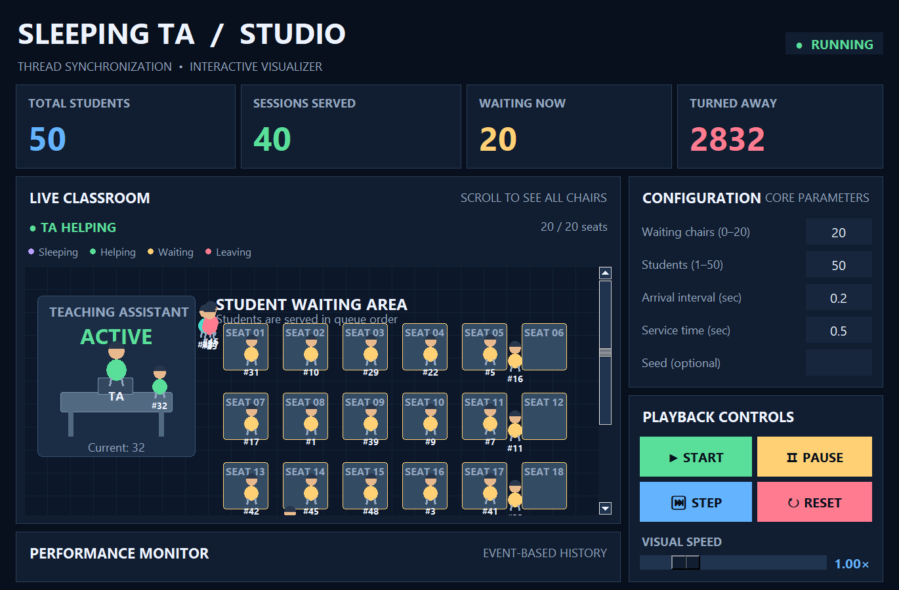
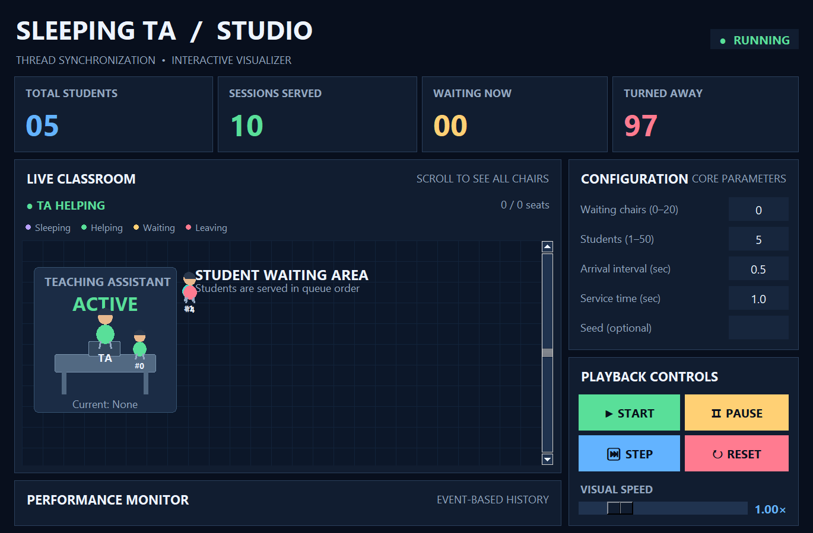

# II-4-10: The Sleeping Teaching Assistant

**F.CSM302 Үйлдлийн систем — Бие даалт 2 (Final, `v2.0-final`)**

Silberschatz, *Operating System Concepts* (10th Edition), Chapter 7, Programming Project 10 дээр суурилсан Sleeping Teaching Assistant симуляци. Олон thread-ийн synchronization-ийг Python-ийн `threading` санаар хэрэгжүүлж, Tkinter dashboard дээр бодит цагт дүрсэлнэ.



| Материал | Тайлбар |
|---|---|
| [Poster](docs/II-4-10_Poster.pdf) | Нэг нүүртэй танилцуулга |
| [Final Report](docs/II-4-10_Final_Report.pdf) | БД2: сайжруулалт, Reviewer Responses, дахин туршилт |
| [Manual](docs/II-4-10_Manual.pdf) | Хэрэглэгчийн болон Operational гарын авлага |
| [Issue Log](docs/II-4-10_Issue_Log.pdf) | Асуудал бүрийн ангилал, шийдвэр, нотолгоо |

---

## Төслийн зорилго

- **Synchronization:** `Thread`, `Semaphore`, `Lock` (mutex) ашиглан TA ба оюутнуудын ажиллагааг синхрончлох. Deadlock, race condition гарахгүй байх.
- **Interactive UI:** TA, хүлээлгийн сандлууд, оюутнуудын ирэлт, дарааллыг хөдөлгөөнт дүрслэлээр харуулах. Дүрслэл нь бодит thread-үүдийн төлөвийг харуулдаг.

## Бодлогын нөхцөл

- TA-ийн өрөөнд 1 сандал (TA), коридорт N хүлээлгийн сандал байна.
- Оюутан байхгүй бол TA унтана.
- Оюутан ирэхэд: TA унтаж байвал сэрээгээд хүлээлгийн сандал алгасан шууд TA-ийн өрөөнд орно (сандлын тоо 0 байсан ч); TA завгүй бөгөөд сул сандал байвал суугаад хүлээнэ; сандал дүүрэн бол буцаж явна (хэсэг хугацааны дараа дахин ирнэ).
- Оюутнууд FIFO дарааллаар үйлчлүүлнэ.

## Багийн мэдээлэл

| Зүйл | Утга |
|---|---|
| Хуваарилалтын код | II-4-10 |
| Сэдэв | The Sleeping Teaching Assistant |
| GitHub | https://github.com/B242270001/F.CSM302_-_-_Assignment |
| Final release | [`v2.0-final`](https://github.com/B242270001/F.CSM302_-_-_Assignment/releases/tag/v2.0-final) |

### Гишүүд

| № | Нэр | Оюутны код |
|---|---|---|
| 1 | А.Төгөлдөр | B242270001 |
| 2 | Ц.Цогтжаргал | B241940005 |
| 3 | Д.Отгон-Эрдэнэ | B222270083 |
| 4 | О.Цэрэнлхавга | B232270113 |
| 5 | Г.Түвшинсайхан | B242270085 |

---

## Quick Start

### Орчны шаардлага

- **Python 3.12 ба түүнээс дээш** (Tk 8.6 эсвэл 9.0). Туршсан: Python 3.14 + Tk 9.0 (macOS, Windows 11), Python 3.12 + Tk 8.6 (Windows 11). BD1-ийн үед Ubuntu + Python 3.12 дээр core тестүүдийг ажиллуулсан. macOS-ийн суурь Python 3.9-д UI зөв зурагдахгүй.
- Гадны сан шаардлагагүй (зөвхөн стандарт сан: `threading`, `tkinter`, `queue`).

### 1. Татаж авах

```bash
git clone https://github.com/B242270001/F.CSM302_-_-_Assignment.git
cd F.CSM302_-_-_Assignment
git checkout v2.0-final      # эцсийн хувилбар (заавал биш)
```

> Хуучин `II-4-10_SleepingTeachingAssistant.git` холбоос мөн ажиллана (GitHub дахин чиглүүлнэ), гэхдээ хавтасны нэр нь `II-4-10_SleepingTeachingAssistant` болно.

### 2. UI-тай ажиллуулах

```bash
python3 src/ui.py
```

Талбаруудад утгаа оруулаад **START** дарна. Жишээ: сандал 0, оюутан 5, ирэх 0.5, үйлчилгээ 1.0 гэвэл TA унтаж байхад ирсэн оюутан шууд үйлчлүүлж, бусад нь буцна.



> **Windows:** `python3`-ийн оронд `python` (эсвэл `py`) гэж бичнэ. Жишээ нь `python src/ui.py`.
> Хэрэв `ui.py` дээр `ta_core` import алдаа гарвал `cd src` хийгээд `python ui.py` гэж ажиллуулна.

### 3. Консол горимд ажиллуулах (UI-гүй)

```bash
python3 src/ta_core.py --chairs 3 --students 5 --interval 1.0 --service 1.5 --duration 10
```

Нэмэлт аргумент: `--seed 42`. Seed нь ирэх болон үйлчилгээний **санамсаргүй хугацааг** тогтмол болгоно. Харин thread-үүдийн гүйцэтгэх дарааллыг OS-ийн scheduler шийддэг тул үйлчлүүлсэн/буцсан тоо ажиллуулалт бүрт бага зэрэг өөр гарна. Ижил seed-ээр бүх тоо давтагдана гэж хүлээх ёсгүй.

---

## UI-ийн хэрэглээ

**Тохиргоо**

| Талбар | Хязгаар |
|---|---|
| Хүлээлгийн сандлын тоо | 0 – 20 (бүхэл) |
| Оюутны тоо | 1 – 50 (бүхэл) |
| Ирэх хугацаа (сек) | 0.001 – 60 |
| Үйлчилгээний хугацаа (сек) | 0.001 – 60 |
| Seed (заавал биш) | бүхэл тоо эсвэл хоосон |

Буруу утга оруулбал `INVALID INPUT` төлөв гарч, симуляци эхлэхгүй.

**Удирдлага**

| Товч | Үйлдэл |
|---|---|
| START | Симуляци эхлүүлэх / түр зогссоныг үргэлжлүүлэх |
| PAUSE | Түр зогсоох |
| STEP | Түр зогссон үед нэг event-ээр урагшлах |
| RESET | Бүх төлөв, тоолуурыг цэвэрлэх |
| Visual speed | Зөвхөн дүрслэлийн хурд (core thread-ийн хугацаанд нөлөөлөхгүй). Core-оос 20-оос олон event хоцорвол UI хамгийн сүүлийн төлөв рүү үсэрнэ |

**Нэмэлт боломжууд:** Event түүхийг төрлөөр нь шүүх (filter), хайх (search), CSV болгон экспортлох боломжтой.

---

## Synchronization-ийн загвар

Номын шийдэлтэй ижил бүтэцтэй:

| Объект | Төрөл | Үүрэг |
|---|---|---|
| `mutex` | `Lock` | Хүлээлгийн дараалал, TA-ийн төлөв, тоолуурыг хамгаална |
| `students_sem` | `Semaphore(0)` | Хүлээж буй оюутны тоо. TA үүн дээр `wait` хийж унтана |
| `turn[i]` | `Semaphore(0)` | Оюутан бүрийн хувийн semaphore. TA үйлчилж дуустал оюутан хүлээнэ |
| `_direct` | `Optional[int]` | TA унтаж байхад түүнийг сэрээсэн оюутан (хүлээлгийн сандал алгасна, БД2) |

Thread бүр өөрийн үйлдлийг `Event` болгон `queue.Queue`-д хийнэ, UI нь `root.after(...)`-ээр уншиж зурна.

---

## Төслийн бүтэц

```
F.CSM302_-_-_Assignment/
├── src/
│   ├── ta_core.py             # Core: Simulation, Config, thread-үүд (UI-аас хамааралгүй)
│   └── ui.py                  # Tkinter dashboard
├── tests/
│   ├── test_ta_core.py        # Багийн автомат тест (11)
│   ├── test_edge_cases.py     # Edge case тест (27)
│   ├── test_review_fixes.py   # БД2: асуудлын засварыг нотлох тест (11)
│   ├── core_scenarios.py      # Core дээрх сценарийн тоо
│   ├── ui_scenarios.py        # UI сценари + screenshot (macOS / Windows)
│   ├── screenshots/           # macOS (БД1)
│   └── screenshots_win32/     # Windows 11 (БД2)
├── docs/
│   ├── II-4-10_Poster.pdf     # БД2: постер
│   ├── II-4-10_Final_Report.pdf # БД2: эцсийн тайлан
│   ├── II-4-10_Report.pdf     # БД1 тайлан
│   ├── II-4-10_Manual.pdf      # Хэрэглэгчийн болон Operational гарын авлага
│   ├── testing_results.pdf     # Туршилтын тайлан
│   ├── testing_results.md
│   └── II-4-10_Issue_Log.pdf   # БД2: асуудлын бүртгэл, шийдвэр, нотолгоо
├── .gitignore
└── README.md
```

---

## Тест ажиллуулах

Төслийн үндсэн хавтсанд:

```bash
python3 -m unittest discover -s tests -v        # бүх 49 тест (11 + 27 + 11), ~1 мин
python3 tests/core_scenarios.py                 # core дээрх бодит тоо (~2 мин)
python3 tests/ui_scenarios.py all               # UI сценари + screenshot (~3.5 мин, macOS / Windows)
```

> Windows дээр `python3`-ийн оронд `python` гэж бичнэ. `ui_scenarios.py` нь Windows дээр screenshot авахдаа Pillow (`pip install pillow`) ашиглана.
> `test_review_fixes.py`-ийн UI тестүүд Tk цонх (нуугдмал) үүсгэдэг тул дэлгэцгүй орчинд автоматаар алгасагдана.

## Туршилтын дүн

| Түвшин | Үр дүн |
|---|---|
| Багийн автомат тест | 11 / 11 тэнцсэн |
| Edge case тест | 27 / 27 тэнцсэн |
| БД2 засварын тест | 11 / 11 тэнцсэн |
| UI сценари (S1–S11) | 11 / 11 тэнцсэн (macOS — БД1, Windows 11 — БД2) |

Python 3.14.7 ба 3.12.10 (Windows 11) дээр бүх 49 тест тэнцсэн.

Дэлгэрэнгүйг [docs/testing_results.pdf](docs/testing_results.pdf)-ээс харна уу.

## Мэдэгдэж буй хязгаарлалт

- Seed нь хугацааны утгыг тогтмол болгодог ч thread-ийн дарааллыг тогтоодоггүй тул тоон үр дүн яг давтагдахгүй (дээрх Quick Start-ыг үз).
- Ачаалал ихтэй үед UI хоцорсон event-үүдийн анимацийг алгасаж хамгийн сүүлийн төлөвийг харуулна. Тоолуур ба лог зөв хэвээр үлдэх боловч алгассан event бүрийн хөдөлгөөн харагдахгүй.
- UI сценарийн тестийг macOS ба Windows 11 дээр ажиллуулсан. Linux дээр Pillow-ийн `ImageGrab` X11 орчин шаарддаг.

### БД2-оор засагдсан (дэлгэрэнгүйг [docs/II-4-10_Issue_Log.pdf](docs/II-4-10_Issue_Log.pdf)-ээс харна уу)

- Сандлын тоо 0 үед TA хэзээ ч үйлчилдэггүй байсан → одоо унтаж буй TA-г сэрээсэн оюутан шууд ордог болсон (M-1).
- Windows дээр тохируулсан бүх хугацаа ~1.56 дахин уртасдаг байсан → `_sleep()` бодит цагийн deadline ашигладаг болсон (M-3).
- Windows дээр консолын гаралтыг pipe эсвэл файл руу чиглүүлэхэд `UnicodeEncodeError` гардаг байсан (m-1).
- Буруу тохиргоотой `reset(new_config)` ажиллаж буй симуляцийг зогсоодог байсан (m-6).
- Ачаалал ихтэй үед UI-ийн "үйлчлүүлсэн" тоо core-оос хоцордог байсан (m-4).
- UI-д seed талбар нэмсэн (S-1). `ui_scenarios.py` Windows дээр ажилладаг болсон (m-3).
